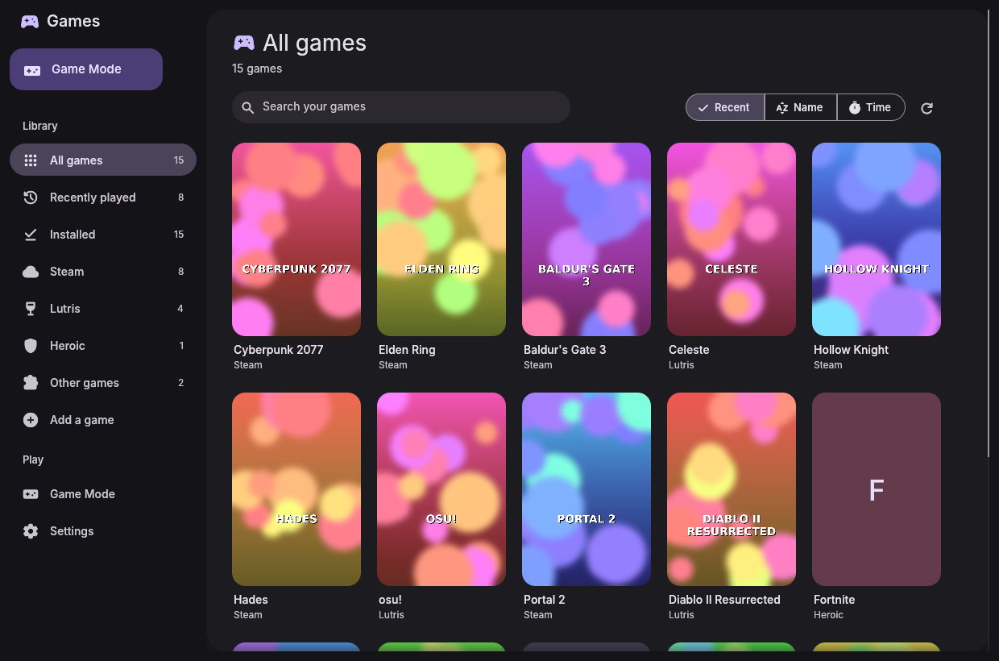
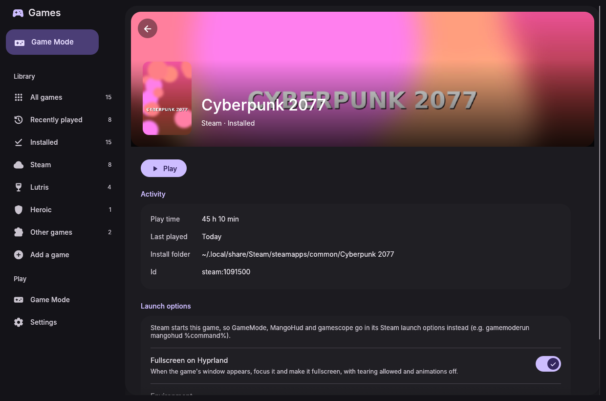
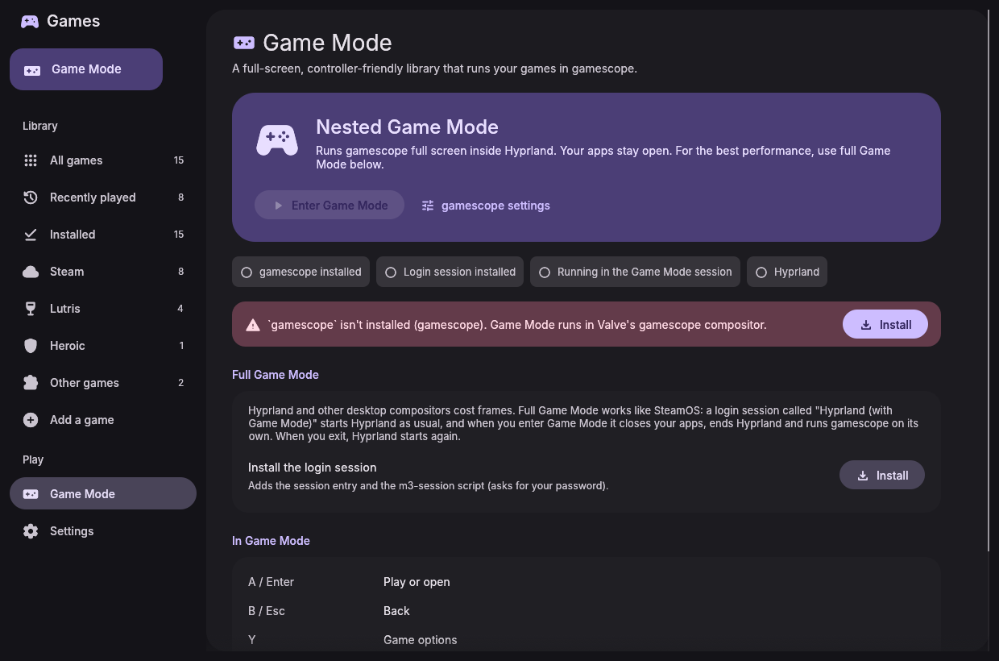
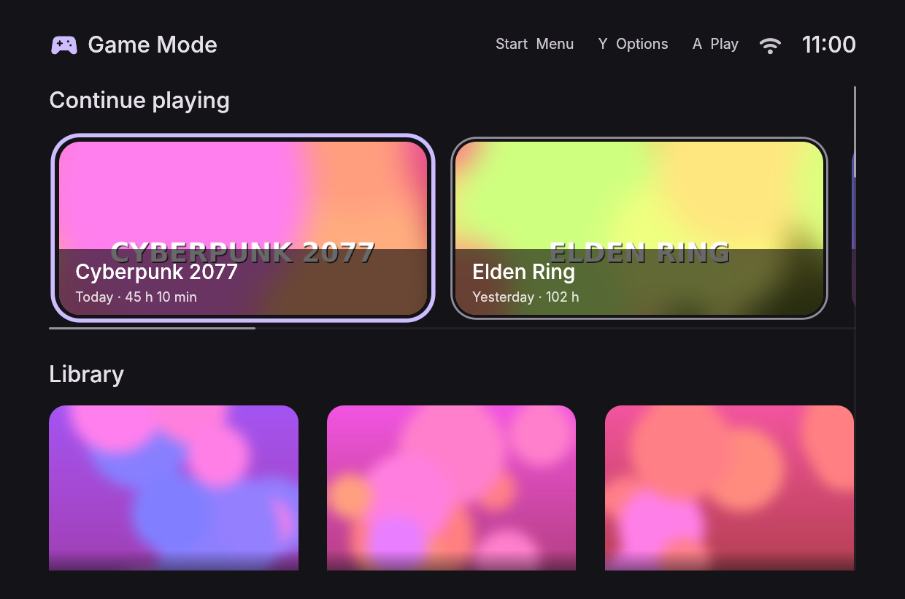
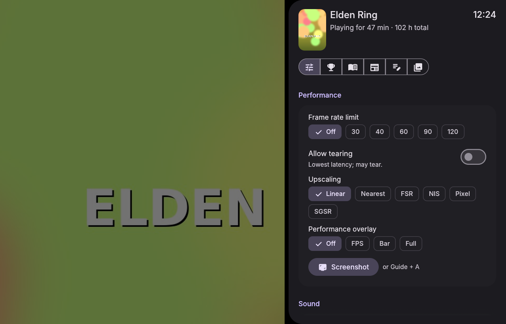
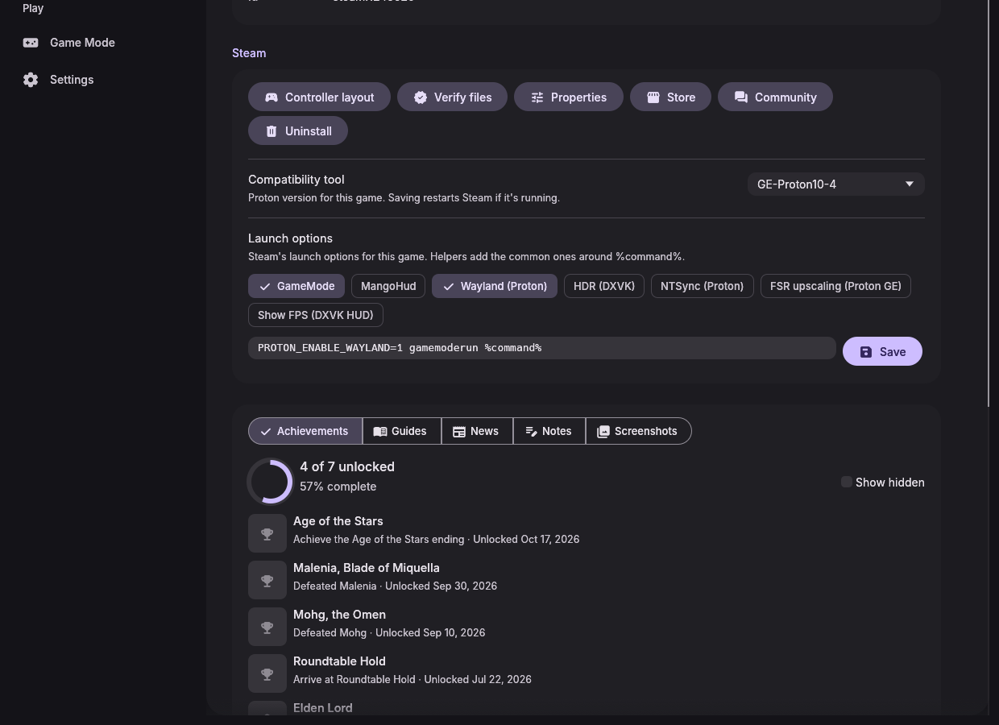
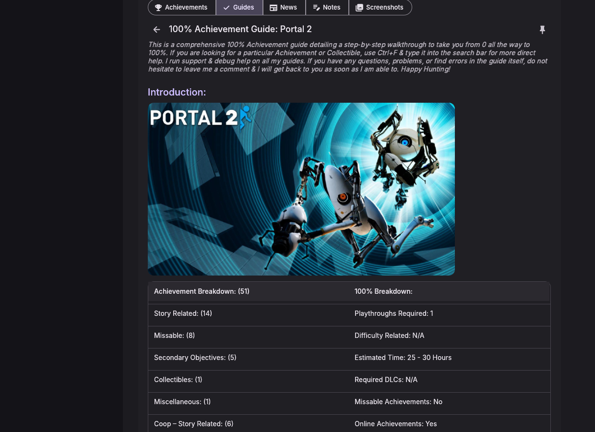
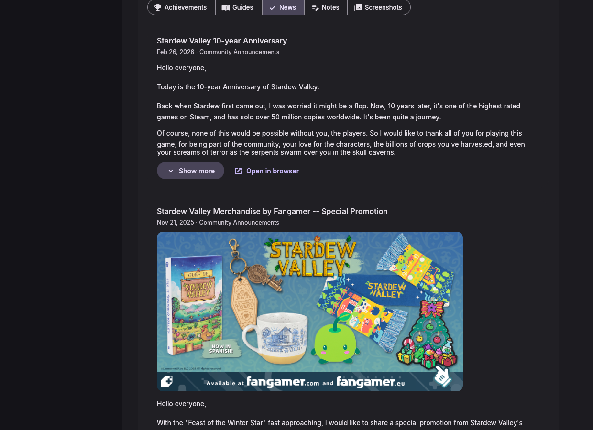
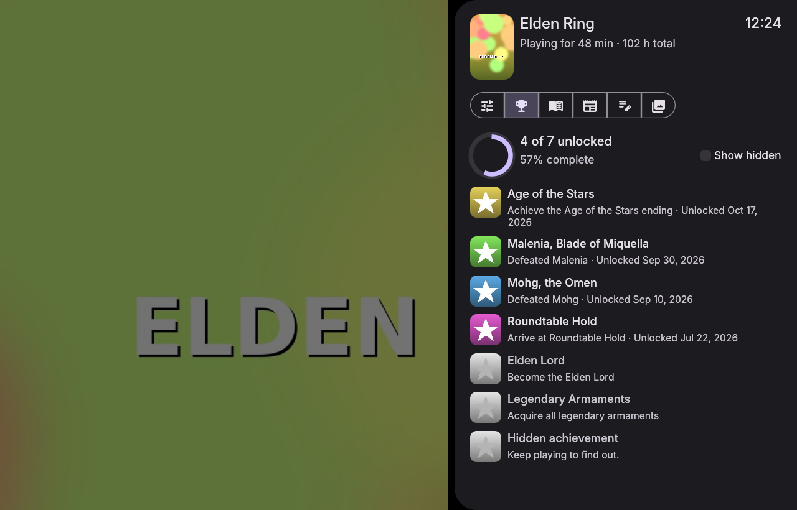

# Material 3 Games

A game manager for Arch Linux and Hyprland, built with [egui](https://github.com/emilk/egui) and themed with Material You to match the [Material 3 File Manager](https://github.com/bhimio1/material-3-file-manager-rust), [Settings](https://github.com/bhimio1/material-3-settings) and [Music](https://github.com/bhimio1/material-3-music) apps. On an end4-pC desktop it takes its colors from your wallpaper, like the shell does.

It has two jobs:
- **Desktop mode:** launch games so they open fullscreen and fast on Hyprland.
- **Game Mode:** leave Hyprland entirely and run games under gamescope, like SteamOS.







## Features

**One library**
- **Steam:** every library folder, cover and hero art from Steam's own cache, and last-played and play time from `localconfig.vdf`. Proton and runtimes are skipped.
- **Lutris:** reads `pga.db`, covers and banners, native or Flatpak. It's the "Lutris-based" part: install and configure games in Lutris, and play them from here.
- **Heroic:** installed Epic, GOG and Amazon games.
- **Apps:** native games from your application menu (`Categories=Game`).
- **Added by hand:** native binaries, or Windows `.exe` files run with Proton through umu-launcher (or Wine). Each game gets its own prefix in `~/Games/m3-games/prefixes`.
- **Cover art:** missing covers come from Steam's CDN (for Steam games, along with the hero banner), Heroic's store art and, with a free API key, SteamGridDB. Downloads are cached in `~/.cache/m3-games/covers`.
- **Library view:** search, sort by recent, name or play time, filters per source, and live updates when you install or remove games.

**Desktop mode on Hyprland**
- **Fullscreen fix:** when a game launches, a small helper watches Hyprland's event socket for its window, focuses it and makes it fullscreen. It recognises Steam games by their `steam_app_<id>` class and others by their process, and ignores launcher and splash windows.
- **Performance mode:** while the game runs, animations, blur and shadows are turned off (`hyprctl eval` on Lua configs, `hyprctl keyword` on hyprland.conf). A reload when it closes turns them back on.
- **Game window rules** (Settings → Hyprland): one click adds a marked block to your config. On end-4 it goes in `custom/rules.lua`, which survives dots updates. The block contains:
  - `allow_tearing`;
  - for Steam games, gamescope, `.exe` windows and games launched here before: `immediate` (tearing for lowest latency), `idle_inhibit = "fullscreen"`, and no animations, blur or shadows.
- **Per-game options:** GameMode, MangoHud, running inside gamescope on the desktop, force fullscreen, and environment variables.
- **Play time:** tracked for games launched here.

**Game Mode**
- **Full Game Mode:** pick the **Hyprland (with Game Mode)** session at login once. It's Hyprland as usual. When you enter Game Mode, it closes your apps (after listing them), exits Hyprland, and runs **gamescope directly on the GPU** with the big-picture UI, so no desktop compositor sits between your game and the screen. **Exit to desktop** brings Hyprland back.
- **Nested Game Mode:** outside that session, gamescope runs fullscreen inside Hyprland, with performance mode on.
- **Big picture:**
  - "Continue playing" hero cards and a cover grid;
  - controller navigation (D-pad or stick to move, A play, Y options, B back, Start menu), plus keyboard and mouse;
  - clock, battery and network in the top bar;
  - a system menu with volume, Steam's own Big Picture (`steam -gamepadui`), exit to desktop, sleep and power off.

**Steam features**



- **Steam Input for every game:**
  - Turn on **Use Steam Input** on a game's page, or use **Add all** in Settings. The game is added to Steam as a non-Steam shortcut (tagged "Material 3 Games", with its cover and hero art) and is launched through Steam from then on.
  - Steam's controller layouts, gyro and Steam's own overlay then apply to Lutris, Heroic and hand-added games too.
  - The shortcut runs `m3-games __run <id>`, so this app's options (GameMode, MangoHud, env, Proton prefix) still apply, and it stays running until the game exits so Steam keeps Steam Input active. **Controller layout** opens Steam's configurator for that shortcut.
  - **Steam restart caveat:** Steam rewrites `shortcuts.vdf`, `config.vdf` and `localconfig.vdf` when it quits, so edits only stick while it's closed. If Steam is running, the app asks, closes Steam, saves (keeping a timestamped `.bak` of the file, newest 10), and starts Steam again.
  - From a terminal or the shell: `m3-games steam-input on|off <id>...`.
- **Achievements:** read from Steam's local cache (`appcache/stats`), with unlock dates and a progress ring. Hidden achievements stay hidden until you ask. With an optional Steam Web API key you get the Web API's exact list. Global unlock percentages need no key. For a game you haven't played on this PC and without a key, the names, icons and percentages come from the game's public achievements page.
- **Guides:**
  - The Steam Community's top-rated guides for each game, in your language (from `$LANG`, with a chip to show every language) and page by page.
  - Guides open in a native reader with headings, lists, tables, quotes, images, small icons beside their text, and links, so no browser is needed. Readable in Game Mode, and cached so they work offline.


  - Pin guides to a game, including any URL or a local Markdown/text file, which works for non-Steam games too.
- **Notes:** per-game notes, shown in the detail page, big picture and the Game Mode overlay.
- **News:** the developer's patch notes and announcements (Steam's news API), laid out like guides with headings, lists, images and YouTube links. Long posts collapse. Outside feeds are shown only when a game has no announcements of its own.


- **Per-game Steam settings:**
  - **Compatibility tool:** Proton versions from Steam and `compatibilitytools.d` (GE-Proton…).
  - **Launch options:** with one-tap helpers for `gamemoderun`, `mangohud`, `PROTON_ENABLE_WAYLAND=1`, `DXVK_HDR=1`, `PROTON_USE_NTSYNC=1`, FSR and the DXVK FPS HUD.
  - **Buttons:** controller layout, verify files, properties, store, community hub, install and uninstall.
- **Screenshots:** Steam's screenshots for the game plus Game Mode screenshots, in a gallery.
- **Owned games (optional):** with a Web API key, games you own but haven't installed show up with an Install button.

**Quick overlay in Game Mode**



Press the controller's **Guide** button while playing to open a side sheet over the game:
- **Performance:**
  - frame rate limit (Off/30/40/60/90/120);
  - allow tearing;
  - upscaling filter (Linear, Nearest, FSR, NIS, Pixel, SGSR) and sharpness;
  - the MangoHud overlay (Off/FPS/Bar/Full; needs `mangohud`).
  
  These are remembered per game and re-applied when you start it.
- **Sound:** volume, mute and output device.
- **Brightness** (with `brightnessctl`).
- **Now playing** controls for the active media player (with `playerctl`; Material 3 Music works).
- **Controller batteries.**
- **This game:** achievements, guides with the reader, notes, screenshots.
- **System:** Screenshot, Quit game, Exit to desktop, Sleep, Restart, Shut down (each confirmed).

Shortcuts: **Guide** shows or hides it, **Guide + A** takes a screenshot (saved to `~/Pictures/Screenshots/Material 3 Games/<game>/`), **Guide + B** quits the game. The D-pad moves between controls, A activates, left/right adjusts sliders, and B goes back or closes. Without a controller, bind `m3-games overlay toggle` (also `show`, `hide`, `screenshot`, `close-game`).

**How it works with gamescope:**
- Game Mode starts gamescope with Steam integration (`-e`), plus `--mangoapp` when MangoHud is installed.
- The overlay is an X11 window marked `STEAM_OVERLAY`, which gamescope draws above the game. Its visibility (`_NET_WM_WINDOW_OPACITY`) and input (`STEAM_INPUT_FOCUS`) are switched when you toggle it.
- The performance controls set gamescope's own root properties (`GAMESCOPE_FPS_LIMIT`, `GAMESCOPE_ALLOW_TEARING`, `GAMESCOPE_NEW_SCALING_FILTER`, `GAMESCOPE_SHARPNESS`, `GAMESCOPECTRL_REQUEST_SCREENSHOT`). The MangoHud level is switched by rewriting `$MANGOHUD_CONFIGFILE`, which gamescope's mangoapp watches.
- Big picture tags its own window (`STEAM_GAME`) and moves focus between itself and the game with `GAMESCOPECTRL_BASELAYER_APPID`.
- gamescope only recognises a game by its app id:
  - Steam games have one already.
  - Other games are started in a `app-steam-app<ID>-<N>.scope` systemd unit, the name gamescope reads app ids from. That needs `systemd-run`; without it, focus falls back to gamescope's default.

**end4-pC integration.** The shell can drive everything through the CLI:

```
m3-games                  # library window
m3-games --big-picture    # big picture
m3-games list --json      # [{"id","name","source","cover","hero","last_played","playtime_minutes","installed"}]
m3-games launch <id>      # e.g. steam:570, lutris:12, heroic:gog:1207658924, manual:my-game
m3-games game-mode        # enter Game Mode
m3-games exit-game-mode
m3-games status --json    # {"game_mode", "session_ready", "running_game": {"id","name","pid",…}|null}
m3-games overlay toggle   # Game Mode overlay: toggle | show | hide | screenshot | close-game
m3-games steam-input on|off <id>...
m3-games scheduler status|gaming|restore   # sched-ext gaming scheduler (see CachyOS)
```

`list --json` may also include `steam_appid` and `steam_shortcut_appid` for each game, and `running_game` may include `started`, `gamescope_appid` and `unit`.

The library is also kept at `~/.cache/m3-games/library.json` (same format as `list --json`), so the shell can read it without starting anything.

## Install

From the AUR, prebuilt or built from source:

```sh
paru -S material-3-games-bin   # or material-3-games-git
```

Prebuilt x86_64 binaries are attached to [releases](https://github.com/bhimio1/material-3-games/releases). The end4-pC fork installs the latest one automatically.

With the included PKGBUILD:

```sh
cd packaging
makepkg -si
```

Or build directly (needs `libudev`, part of systemd):

```sh
cargo build --release
./target/release/m3-games
```

The packages install the `Hyprland (with Game Mode)` session entry and the `m3-session` script. With a `~/.local` install, use Game Mode → **Install** (one password prompt) instead.

Optional tools, each offered for install where it's needed:
- `gamescope`: Game Mode.
- `umu-launcher`: Windows games with Proton.
- `gamemode`, `mangohud`: per-game tuning and overlay.
- `steam`, `lutris`: their own game libraries.

Install buttons install repository packages with `sudo pacman -S --needed`. Packages that aren't in any configured repository come from the AUR with `paru`, or `yay` if paru isn't installed. Which is which is checked with `pacman -Si` when the command runs.

## CachyOS

CachyOS works like Arch, with a few extras:

- **Packages:** CachyOS's own repositories carry gamescope, MangoHud, umu-launcher and Proton-CachyOS, so Install buttons use `sudo pacman` for them, not paru. Settings → CachyOS offers `cachyos-gaming-meta` and `cachyos-gaming-applications` when they aren't installed.
- **Proton-CachyOS:**
  - Steam's compatibility tool picker lists `proton-cachyos` and `proton-cachyos-slr` from `/usr/share/steam/compatibilitytools.d` as "Proton-CachyOS".
  - Windows games run with umu use Proton-CachyOS when it's installed and no Proton version is set. Otherwise they use GE-Proton.
- **game-performance:** with `cachyos-settings` installed, games you start here get a "CachyOS performance profile" option. It runs the game through `game-performance`, which uses the performance power profile while you play. For Steam games, the launch-option helpers add `game-performance %command%`.

  It overlaps with GameMode, so one of them is usually enough. Both can be on.
- **sched-ext schedulers:** with `scx-scheds` and `scx-manager` (scx_loader, `scxctl`) installed, Settings → CachyOS → **Gaming scheduler** switches scheduler when Game Mode starts. The default is `scx_lavd` in gaming mode.
  - Optionally it also switches while a game runs on the desktop.
  - The previous scheduler comes back afterwards: when the big-picture UI quits, or from `m3-session` after gamescope exits.
  - The Game Mode overlay shows the current scheduler, with chips to switch scheduler and mode.
  - All of this is hidden when `scxctl` isn't installed.
- **Login session:** fish is CachyOS's default shell. `m3-session` runs with bash directly and never reads shell rc files. The session entry uses absolute paths, so SDDM starts it the same with any login shell:
  - The package's entry runs `/usr/bin/m3-session`.
  - The one installed from Game Mode → **Install** runs `/usr/local/bin/m3-session` and passes the `m3-games` path in `M3_GAMES_BIN`.

## Notes

- **Hyprland config syntax:** Hyprland 0.55+ uses Lua configs, where `hyprctl keyword` doesn't apply; the app uses `hyprctl eval` there. For `hyprland.conf`, rules are written in the 0.53+ `windowrule = match:class …, immediate on, …` form; older versions need `windowrulev2` syntax instead.
- **Store-launched games:** Steam, Lutris and Heroic start their own games, so set GameMode, MangoHud and gamescope in those launchers (for Steam: `gamemoderun mangohud %command%` in launch options). Fullscreen handling and performance mode still apply.
- **Steam window classes:** games running under Steam use the `steam_app_<id>` class, which is how their windows are matched. Non-Steam games launched through their Steam shortcut are matched by the `SteamGameId` Steam puts in their environment.
- **Steam Input with Lutris and Heroic:** Steam keeps Steam Input on while `m3-games __run` is alive.
  - For Lutris it waits until no process carrying the shortcut's `SteamGameId` is left. This works when Lutris starts fresh. If the Lutris window is already open, Lutris may run the game in its existing process, outside Steam's tracking.
  - Heroic hands the launch to its own process the same way.
- **Unverified parts:**
  - Guide pages are parsed from Steam Community HTML, which has no API. The parser follows the class names Steam has used for years and degrades gracefully; it was tested against sample pages, not live ones.
  - The gamescope integration follows gamescope's source (steamcompmgr.cpp, Process.cpp). It was tested against an X server, not a live gamescope session.
  - The scheduler switching follows scx-loader's `scxctl` (its subcommands and output). It was tested against a stand-in `scxctl`, not a live scx_loader.

## Configuration

- **Settings:** `~/.config/m3-games/config.toml`.
- **Games added by hand:** `~/.config/m3-games/games.toml`.
- **Play statistics:** `~/.local/share/m3-games/stats.json`.

## Project layout

```
src/
  app.rs          state, theme, scanning, launching, actions (desktop + big picture)
  library/        Steam (vdf.rs, steam.rs), Lutris, Heroic, desktop entries, manual games
  launch.rs       commands per source with gamemode/MangoHud/gamescope wrappers
  watch.rs        background helper: catch the game window, fullscreen it, track play time
  hypr.rs         Hyprland: rules block (Lua/hyprlang), event socket, clients, perf mode
  session.rs      Game Mode: m3-session handshake, closing apps, nested gamescope
  gamescope.rs    gamescope X11 control (focus, FPS limit, scaling, screenshots, overlay atoms)
  gamesession.rs  tracking/stopping a game started in Game Mode (scope units, Steam env)
  overlay/        the Game Mode quick overlay: window, controls, IPC socket
  steam/          binary/text VDF, shortcuts (Steam Input), achievements, guides, news,
                  Proton & launch options, Web API
  procenv.rs      reading other processes' environment
  sys/            commands, terminals, background tasks, os-release and pacman (os.rs),
                  sched-ext via scxctl (scx.rs), overlay quick settings (quick.rs)
  gamepad.rs      controller input (gilrs)
  covers.rs       cover cache: Steam CDN, Heroic art, SteamGridDB
  ui/             sidebar, pages, big picture, Steam extras (steamui.rs), M3 widgets
packaging/        PKGBUILD, AUR -bin template, desktop files, m3-session
```

Run the tests with `cargo test`.

## License

MIT, see [LICENSE](LICENSE).

Fonts: Inter (SIL OFL 1.1, see `assets/fonts/LICENSE-Inter.txt`). Icons: Material Symbols, via `egui_material_icons`.
